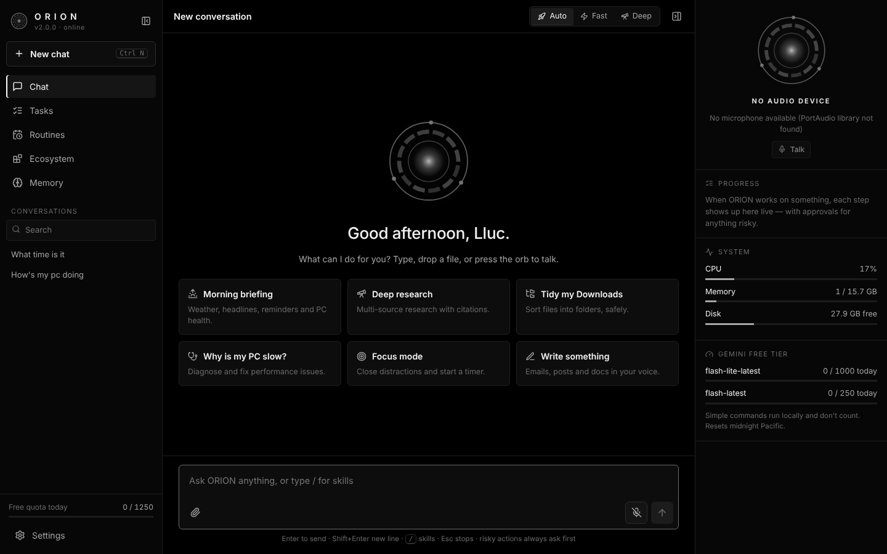
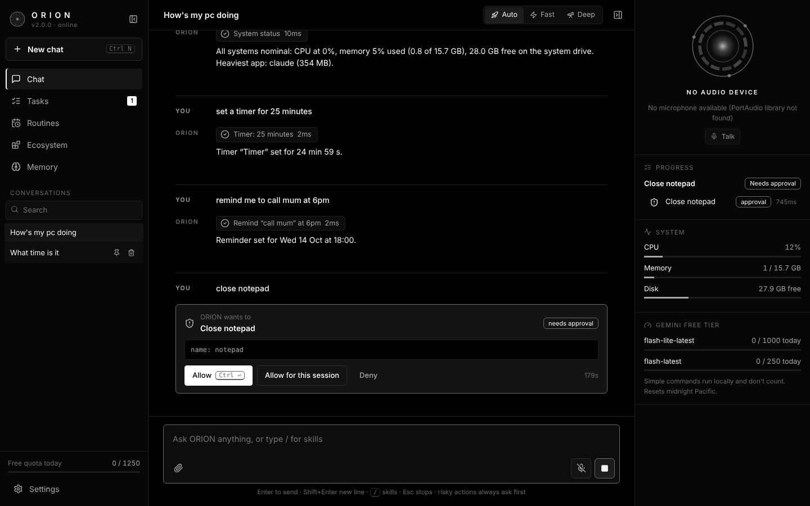

# O.R.I.O.N. 2.3

**A voice-first AI assistant for your Windows PC, in the spirit of J.A.R.V.I.S.** Talk to it or type to it.
It opens apps, controls the system, manages files, reads your screen, searches the web, runs scheduled routines
and plugs into thousands of services. It runs on a **free Gemini API key**.

ORION 2.0 is a complete rewrite of the 1.x "LIV Edition" prototype. It is a real desktop application: a native window,
a tray icon, global hotkeys, a Quick Bar over any app, an installer, and a modular engine you can extend.



---

## What it does

| | |
|---|---|
| **Talk naturally** | *Live* voice mode streams to Gemini's native-audio model for real-time conversation you can interrupt. An optional offline **"Hey Jarvis"** wake word means audio leaves the PC only after you say it. |
| **Instant commands** | "open Spotify", "volume 30", "next song", "timer 10 minutes", "lock my PC": about 40 common commands run **on-device in milliseconds and use no API quota**. |
| **Operates your PC** | Launch and close apps; drive Windows controls via UI Automation; volume, brightness, media and power; files (search, read PDF/Word, write with read-back verification, move, Recycle Bin delete); clipboard; keyboard and mouse; screenshots and **screen vision**. |
| **Knows things** | Web search and page reading (DuckDuckGo, free), weather (Open-Meteo, free), and long-term **memory** of you, stored locally. |
| **Works like Cowork** | Each job becomes a **task** with a live checklist and step log. Risky steps pause for your **approval**. Stop everything with one key. |
| **Skills** | Packaged playbooks: `/morning-briefing`, `/deep-research`, `/file-organizer`, `/pc-doctor`, `/focus-mode`, `/writer`. Write your own in the app. |
| **Routines** | "Every weekday at 8:00, run my briefing." Timers and reminders persist and catch up after a restart. |
| **Connectors** | **MCP** (Model Context Protocol), the same open standard Claude and Cowork use. Add GitHub, Notion, a real browser (Playwright), Home Assistant and more from a catalog, or any MCP server. |
| **Plugins** | Drop a Python file with an `@tool` function into the plugins folder and ORION can use it. |
| **Email & calendar** | Connect any IMAP/SMTP mailbox with an app password (Gmail, iCloud, Yahoo, Outlook…) and your calendars' private iCal links. ORION reads, searches and sends email (sending asks first), lists your schedule including recurring events, and opens new events pre-filled. No Google Cloud setup needed. |
| **Phone app** | Turn it on in Settings, scan the QR code, and "Add to Home Screen". Your phone gets an installable ORION app: chat with hold-to-talk voice, media, volume, apps and smart-home controls, a **live view of your screen** you can tap to click, and approvals as **push notifications** with Approve/Deny buttons. It works away from home through Tailscale or a free Cloudflare tunnel. Each phone has its own revocable key and can't change settings. |
| **Missions** | "Research the best budget gaming laptops and put a comparison on my desktop." Missions run in the background with a plan, many steps and the deep model. They wait out free-tier limits, and ORION notifies your PC and phone when they finish. |
| **Proactive** | ORION speaks up by itself: low battery, CPU or RAM running hot for a while, a disk nearly full, a finished download, an upcoming calendar event, the internet dropping. It respects quiet hours. |
| **Smart home** | Home Assistant (URL + token) and Philips Hue (press the bridge button to pair). "Turn off the bedroom lights" and "dim the lamp to 30%" run instantly; scenes and locks/alarms (always asks first) go through the assistant. |
| **Deep memory** | When a conversation goes quiet, ORION picks out lasting facts (people, projects, preferences, plans) and remembers them. It skips duplicates, has a daily cap to protect your quota, and everything it learns can be deleted in Memory. |
| **Undo** | ORION journals every file change it makes and backs up anything it overwrites, so "undo that" restores it. |
| **System check** | Settings → About → System check tests your key, models, microphone, speakers, voice, search and app control, and says how to fix anything broken. |
| **Spoken approvals** | When a task you started by voice needs permission, ORION asks out loud ("Shall I go ahead?") and accepts yes or no. |



## Built to stay fast on the free tier

Gemini's free tier is limited mainly by **requests per minute and per day**, so ORION is designed to spend as few
requests as possible:

1. **Local fast path.** Common commands never reach the API.
2. **Model routing.** Everyday requests go to **Flash-Lite** (the biggest free quota). Research, writing, multi-step
   jobs and vision go to **Flash**. `-latest` aliases keep working when Google retires versions.
3. **Governor.** ORION tracks each model's RPM and RPD itself and paces requests before Google returns errors. It
   waits briefly for a free slot, falls back to the other model, and honours `retryDelay` when it is throttled. The
   quota meter in the UI shows where you stand.
4. **Lean context.** Only the last N turns are sent, plus the few memories relevant to the request (SQLite FTS5).
   Skills are loaded only when needed. Thinking is off by default for the lowest latency.
5. **Free services for the rest.** Search, weather and Edge neural TTS cost no Gemini quota.
6. **Parallel lookups.** When Gemini asks for several read-only things at once (weather, news, calendar…), they run
   concurrently, so a briefing takes as long as its slowest lookup.
7. **Speech starts early.** In Classic voice mode, each sentence is spoken as soon as it's generated.
8. **Live voice closes itself.** The Live session disconnects after 90 s of silence, and the wake word keeps the
   mic local until you need it.

Default limits are deliberately conservative (Flash-Lite 15 RPM / 1000 RPD, Flash 10 RPM / 250 RPD). Google changes
free quotas from time to time, so match them to what AI Studio shows for your key in **Settings → Brain**.

## Install (Windows)

**Option A: installer (recommended).** Download `ORION-Setup-x.y.z.exe` from Releases and run it. No Python needed.
On first launch, ORION asks for your name and a free API key from
[aistudio.google.com/apikey](https://aistudio.google.com/apikey). The key is stored in Windows Credential Manager.

**Option B: from source.**

```bat
git clone <this repo> && cd ORION
SETUP.cmd          :: creates .venv and installs ORION
ORION.cmd          :: starts it
```

Optional extras:
- `pip install openwakeword` enables the offline "Hey Jarvis" wake word. Then enable it in Settings → Voice.
- Install [Everything](https://www.voidtools.com/) and its `es.exe` CLI for instant file search across all drives.
- Install Node.js and/or [uv](https://docs.astral.sh/uv/) to use MCP connectors from the catalog.

**Build the .exe and installer yourself:** `BUILD.cmd` (needs Node.js; [Inno Setup 6](https://jrsoftware.org/isinfo.php)
for the installer). Pushing a `v*` tag to GitHub builds and publishes the installer automatically
(`.github/workflows/release.yml`).

## Using ORION

| Shortcut | Action |
|---|---|
| `Alt+Space` (anywhere) | Quick Bar: a Spotlight-style command box over any app |
| `Ctrl+Alt+J` (anywhere) | Start or stop talking |
| `Ctrl+K` / `Ctrl+N` / `Ctrl+B` | Focus input / new chat / toggle sidebar |
| `Esc` or `Ctrl+.` | Stop all running tasks |
| `Ctrl+Enter` | Approve the pending action |
| `/` in the input | Pick a skill |

Things to try: *"what's on my screen?"*, *"find the PDF I downloaded yesterday and summarise it"*, *"organise my
Downloads"*, *"why is my PC slow?"*, *"remind me to stretch in 45 minutes"*, *"every Friday at 5pm tell me what I
worked on this week"*.

### Safety model
- **Safe** tools (reading, searching, volume…) run immediately.
- **Confirm** tools (writing files, typing, clicking, closing apps) ask first. You can allow a tool for the rest of
  the session.
- **High-risk** tools (deleting, shell and Python, power, killing processes) always ask, unless you choose *Trust*
  mode.
- File changes are limited to your user folder plus folders you add. Deletes go to the Recycle Bin. Writes and moves
  are verified.
- The engine listens on `127.0.0.1` only and requires a random per-launch token, so websites and other programs
  can't drive it. The phone app uses a separate server (off by default) that only accepts paired devices. Each device
  has its own hashed key, failed pairing attempts are throttled, and admin actions (settings, keys, plugins) are
  blocked from the phone.

## Architecture

```
┌────────────── Desktop shell (pywebview · tray · global hotkeys · Quick Bar) ──────────────┐
│  React UI (ui/ → orion/web)  ◀── WebSocket events / REST ──▶  FastAPI (127.0.0.1 + token)  │
└────────────────────────────────────────────┬──────────────────────────────────────────────┘
                                             │
                      Engine (asyncio) ──────┼───────────────────────────────────────────┐
  brain/router.py   local fast path (0 API calls)                                        │
  brain/agent.py    tool-calling loop · plans · approvals · stop                         │
  brain/gemini.py   streaming client with model fallback, vision, transcription          │
  brain/governor.py free-tier RPM/RPD pacing and cooldowns                               │
  tools/*           ~58 built-in tools (@tool → JSON schema automatically)               │
  skills/           SKILL.md playbooks (built-in + yours)                                │
  ecosystem/        MCP connectors · Python plugins                                      │
  tasks/            task tracker · approval broker · scheduler (routines, reminders)     │
  memory/store.py   SQLite: conversations, FTS memory, tasks, routines, usage           │
  voice/            Gemini Live session · wake word · mic/speaker · edge-tts            │
└────────────────────────────────────────────────────────────────────────────────────────┘
```

User data lives in `%APPDATA%\ORION` (settings, `orion.db`, `skills/`, `plugins/`, `connectors.json`, logs).
Set `ORION_HOME` to move it.

### Writing a plugin

```python
# %APPDATA%\ORION\plugins\lamp.py
from orion.tools.registry import tool

@tool(risk="confirm", category="home")
def desk_lamp(on: bool) -> str:
    """Turn the desk lamp on or off.

    Args:
        on: True to switch it on.
    """
    ...
    return "Lamp on." if on else "Lamp off."
```

Then click **Ecosystem → Plugins → Reload**.

## Development

```bash
python -m venv .venv && . .venv/bin/activate      # Windows: .venv\Scripts\activate
pip install -e ".[dev,docs]"
python -m orion --headless --port 8765             # engine + API only
cd ui && npm install && npm run dev                # hot-reloading UI on :5173 (proxies to 8765)
python -m pytest                                   # 98 tests, including the agent loop against a scripted fake Gemini
```

`GEMINI_API_KEY=… python scripts/live_check.py` runs about 5 real Gemini requests. It checks the key, both models,
that Google accepts every tool schema, tool calling, vision and the Live handshake. CI runs it automatically when the
repository has a `GEMINI_API_KEY` secret. The release workflow also launches the frozen `ORION.exe` on Windows and
smoke-tests its API and UI before it builds the installer.

`python -m orion --browser` uses your normal browser instead of the native window. `--debug` turns on verbose
logging (logs are in `%APPDATA%\ORION\logs`).

## Roadmap ideas
- Full Google and Microsoft OAuth (write access to calendars, labels and folders) as an alternative to app passwords
- Screen-watch mode (ORION notices what you're doing and offers help)
- Browser control built in (drive a real Chrome session without a connector)
- Multiple PCs paired to one phone
- Local STT/LLM fallback (faster-whisper, Ollama) for offline use
- Per-skill tool allowlists and a skill marketplace
